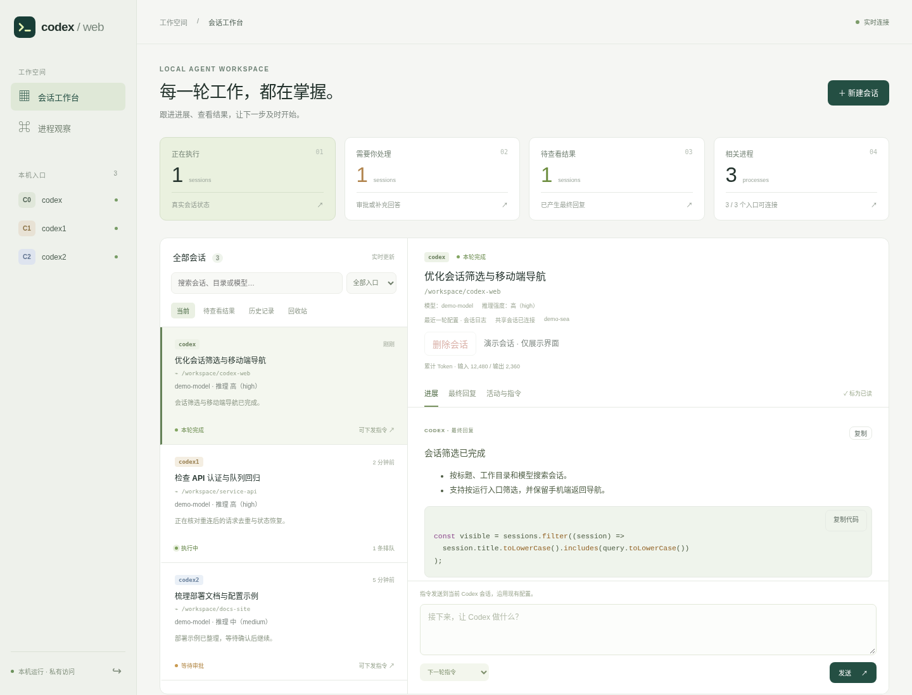
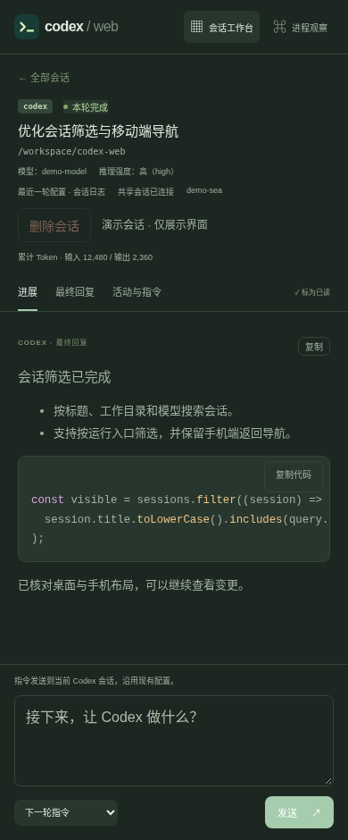
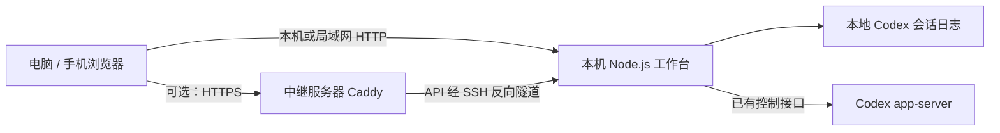

<p align="center">
  
</p>

<h1 align="center">Codex Web</h1>

<p align="center">
  <strong>把本机 Codex 会话带到浏览器。</strong><br />
  在桌面与手机上查看进展、阅读结果，并通过可用的控制接口接续工作。
</p>

<p align="center">
  <a href="https://github.com/Renwang-Huang/codex-web/actions/workflows/ci.yml"></a>
  <a href="package.json"></a>
  <a href="#兼容性"></a>
</p>

<p align="center">
  <a href="#快速开始">快速开始</a> ·
  <a href="#功能概览">功能概览</a> ·
  <a href="docs/DEPLOYMENT.md">部署指南</a> ·
  <a href="docs/USAGE.md">使用指南</a> ·
  <a href="https://github.com/Renwang-Huang/codex-web/issues">反馈问题</a>
</p>



<details>
<summary>查看手机与深色界面</summary>

<p align="center">
  
</p>

</details>

*截图由真实前端在隔离演示数据下生成，模型、会话、目录和连接状态均为示例。*

## 为什么做这个项目

同时使用多个 Codex 入口时，任务进展、最终回复和待处理请求会分散在不同终端。Codex Web 将同一 Linux 用户下的 `codex`、`codex1`、`codex2` 汇集到一个浏览器工作台，让你在电脑上集中查看，也能从手机跟进。

工作台读取本机进程与会话日志，并发现已有的 Codex 控制接口。你可以按当前连接能力查看进展、排队下一轮或继续会话；原有认证、模型提供方与工作目录继续由 Codex 管理。

## 功能概览

| 你想做的事 | 工作台提供的能力 |
| --- | --- |
| 集中查看多个入口 | 按入口、状态或关键词筛选会话，查看相关进程与工作目录 |
| 跟进正在执行的任务 | 展示公开进展、计划、工具活动与明确的轮次状态；SSE 传递文字增量 |
| 快速阅读和带走结果 | Markdown、代码高亮、复制原文或代码，集中查看未读最终回复 |
| 从手机继续查看 | 自适应布局、返回与前进、刷新恢复会话、系统深色主题、唤醒后核对状态 |
| 继续或管理会话 | 在控制连接可用时，新建、续接、排队、补充、中断，以及处理已同步的审批与问题 |
| 找回归档内容 | 使用 Codex 官方归档与恢复，运行中或有未处理指令的会话受到保护 |
| 核对模型与用量 | 显示模型、推理强度及其来源，区分累计 Token 与最近请求信息 |

完整的操作说明与发送语义见 [使用指南](docs/USAGE.md)。

## 快速开始

需要 **Linux、Node.js 22+**，以及已经安装并配置好的 Codex CLI。浏览器查看日志与下发指令有不同的接口要求，先阅读下方兼容说明。

> [!IMPORTANT]
> 控制功能取决于当前 CLI 提供的接口。CLI **0.164.0** 有历史实机验证；最近一次 **0.165.0** 环境检查（2026-10-29）未发现可连接控制接口，该环境的发送、队列、审批和中断尚未重新验收。具体范围见 [验收记录](docs/ACCEPTANCE.md)。

**1. 安装并启动**

```sh
git clone https://github.com/Renwang-Huang/codex-web.git
cd codex-web
npm ci
npm start
```

打开 **http://127.0.0.1:4317**。项目使用原生浏览器模块，安装依赖后即可运行，无需前端构建。

**2. 登录工作台**

在另一个终端中进入项目目录，读取首次启动自动生成的访问密钥：

```sh
cat .local/access-key
```

将密钥填入登录页。它只用于此工作台，权限为 `0600`；浏览器使用 HttpOnly 会话 Cookie，登录有效期为 12 小时。

**3. 检查当前连接能力**

```sh
npm run probe
```

此命令只读查询已发现的控制接口；没有输出表示没有发现接口。可以先查看历史记录和可识别的终端进展，控制操作需满足下方条件。每个项目目录只运行一个工作台实例；已有 systemd 托管服务时，请使用 [服务管理命令](docs/USAGE.md#服务管理可选)。

## 兼容性

| 会话或环境 | 查看进展 | 可用的控制方式 |
| --- | --- | --- |
| 已连接 Unix WebSocket 的 app-server 会话 | 官方状态与本地日志 | 下一轮、排队、补充、中断；处理当前连接收到的审批或问题 |
| 已连接原生队列的独立终端 | 完整活动日志中的轮次事件 | 可排队下一轮并撤回未接收指令；即时补充和中断在原终端操作 |
| 未提供兼容控制接口的独立终端 | 进程与可识别的活动日志 | 监控；退出原终端后，还需同入口有可用 app-server 才能由网页续接 |
| 已离线的历史会话 | 本地日志与结果摘要 | 同入口有可用 app-server 时可续接 |

入口按 `CODEX_HOME` 区分，目前固定为 `~/.codex`、`~/.codex1`、`~/.codex2`。工作台不会自动启动、升级或改造 Codex 控制服务；普通终端进程存在不保证可以下发指令。当前面向单用户 Linux 环境，不支持 Windows、远端 SSH 进程或未知的额外 home。

## 数据与部署



默认仅监听本机回环地址。跨网络访问可复用 **Caddy + OpenSSH**：中继提供静态前端和 API 转发，Codex 在本机运行。本机不需要公网 IP 或路由器端口映射。配置步骤、更新和回退见 [部署指南](docs/DEPLOYMENT.md)。

- **数据位置**：Codex 的凭据与会话留在各自的 home；工作台密钥、指令台账和去重回执保存在 `.local/`，不进入 Git。
- **发送语义**：请求编号去重；断连或超时后保留“结果未知”，不自动重发。跨客户端仍可能竞争，需要严格串行时使用同一发送端。
- **访问边界**：当前使用单用户共享密钥；代理能接触转发内容，这条链路不提供对中继不可见的端到端内容加密。

更多认证、代理与备份细节见 [安全说明](SECURITY.md)。

<details>
<summary>环境变量与可信局域网访问</summary>

| 变量 | 默认值 | 用途 |
| --- | --- | --- |
| `HOST` | `127.0.0.1` | 本机 HTTP 监听地址 |
| `PORT` | `4317` | HTTP 端口 |
| `CODEX_WEB_DATA_DIR` | 项目 `.local/` | 访问密钥、状态、审计与去重回执目录 |
| `PUBLIC_ORIGIN` | 未设置 | 部署 HTTPS 中继时固定公开 Origin |
| `TRUST_LOOPBACK_PROXY` | 未启用 | 设为 `1` 时信任回环代理的来源和协议信息 |

在可信局域网中，可停止现有实例后执行：

```sh
HOST=0.0.0.0 npm start
```

手机打开 `http://电脑的局域网IP:4317`，使用同一密钥登录。直接 HTTP 不提供传输加密，跨网络使用 HTTPS 中继或私人网络。

</details>

## 开发与验证

```sh
npm test                     # 隔离服务端回归
npm run test:review-browser   # 独立 HTTP/SSE 浏览器回归
```

GitHub Actions 在 **Node.js 22、24** 上运行自动化测试，并独立执行 Chromium 浏览器回归。这些测试不调用真实模型；真实会话和服务恢复脚本需人工触发，行为范围见 [贡献说明](CONTRIBUTING.md)。

最近一次验证包含 **41 项自动化测试、6 组浏览器回归**；它们覆盖状态、去重、队列、认证、Markdown 与手机交互，不替代当前 CLI 环境的真实控制链路验收。

## 文档导航

| 文档 | 内容 |
| --- | --- |
| [使用指南](docs/USAGE.md) | 页面操作、队列、归档恢复、服务管理和发送边界 |
| [部署指南](docs/DEPLOYMENT.md) | HTTPS、受限反向隧道、配置核验、更新与回退 |
| [架构与方案比较](docs/ARCHITECTURE.md) | 数据来源、控制协议和已有方案取舍 |
| [验收记录](docs/ACCEPTANCE.md) | 自动化、历史实机结果与未覆盖项 |
| [文档与代码索引](docs/README.md) | 模块职责、维护资料和历史材料 |
| [参与开发](CONTRIBUTING.md) | 测试、截图生成和提交约定 |

功能建议和复现问题可提交到 [GitHub Issues](https://github.com/Renwang-Huang/codex-web/issues)；涉及凭据或安全漏洞时，请使用 [私密漏洞报告](https://github.com/Renwang-Huang/codex-web/security/advisories/new)，并参考 [SECURITY.md](SECURITY.md)。

## 参考与许可

README 的信息组织参考了 [OpenCode](https://github.com/anomalyco/opencode)、[HAPI](https://github.com/tiann/hapi)、[Open WebUI](https://github.com/open-webui/open-webui) 与 [Uptime Kuma](https://github.com/louislam/uptime-kuma)，采用清晰的项目定位、界面预览、快速开始和分层文档。

项目自有代码尚未指定开源许可证。Marked、DOMPurify、Highlight.js 等组件按各自许可证提供，详见 [第三方依赖声明](THIRD_PARTY_NOTICES.md)。
